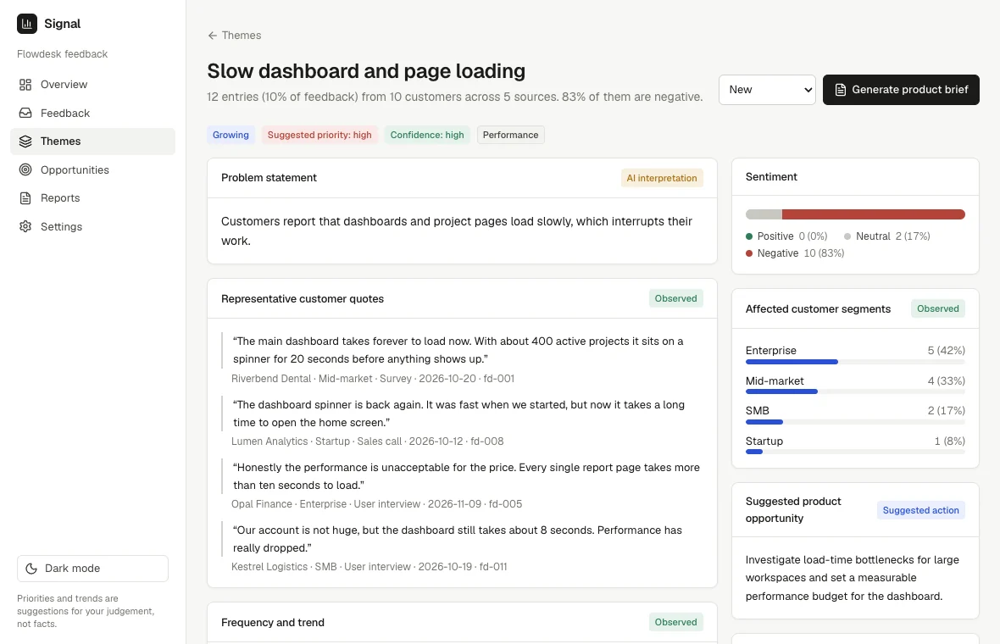
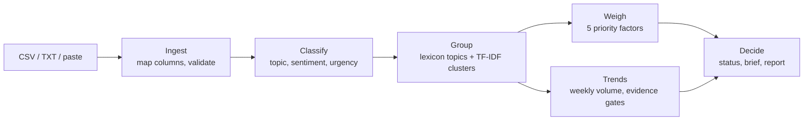
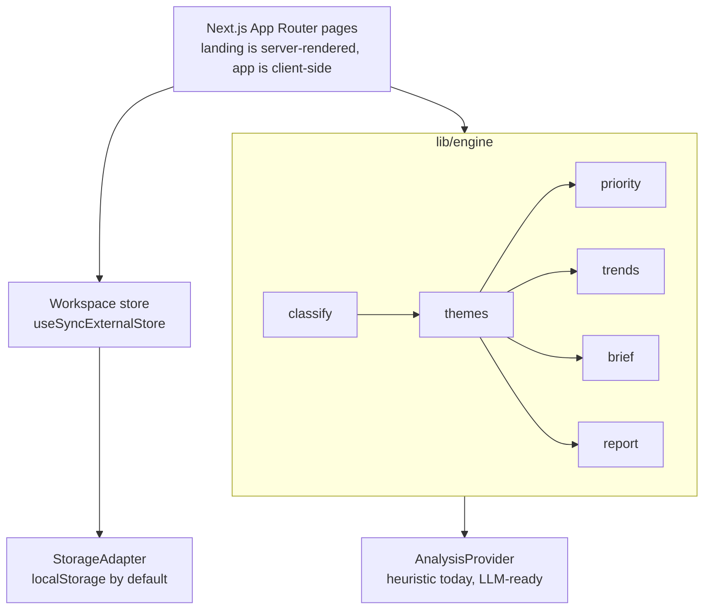

<div align="center">

# Signal

### Turn feedback noise into product signal.

Signal groups support tickets, app reviews and interviews into themes,<br>
shows the exact customer words behind every one, and helps a PM decide what matters.

[](https://signal-voc.vercel.app)

[](https://github.com/batool-fariha/signal/actions/workflows/ci.yml)
[](LICENSE)


[Try it](https://signal-voc.vercel.app) · [What it does](#what-it-does) · [Quick start](#quick-start) · [Import your data](#import-your-own-data) · [Architecture](#architecture) · [Roadmap](#roadmap)

<br>


</div>

> **No sign-up, no API key, nothing uploaded.** Open the live demo, press **Try the demo**, and you are looking at 115 real-looking feedback entries for a fictional product called Flowdesk.

## Why Signal

Product teams hear from customers everywhere: support tickets, app reviews, sales calls, interviews, surveys, Slack. The feedback is fragmented, repetitive and hard to turn into a decision. Most tools respond by summarising it, which hides the evidence a PM needs to trust the conclusion.

Signal takes the opposite approach. It is **an analysis workspace, not a chatbot**: a table, a dashboard and a set of themes you can open up and check, with every claim traceable to a customer's own words.

| Instead of | Signal gives you |
|---|---|
| A wall of comments in a spreadsheet | Themes with a problem statement, quotes, segments and a timeline |
| "Most mentioned" as a proxy for importance | Five priority factors scored separately, each with its reason |
| A confident summary you cannot verify | Verbatim quotes that link back to the original entry |
| A trend line drawn from three data points | A **potential pattern** label until the evidence is there |

**Built for** product managers at B2B SaaS and digital product companies, especially associate and mid-level PMs who own feedback and prioritisation. Also useful to founders without a research team, customer success, UX research and product ops.

## What it does

<table>
<tr>
<td width="50%" valign="top">

**1. Import** from CSV, TXT, pasted text or the sample. Columns are matched automatically, and you see a preview and validation summary before anything lands.

**2. Analyse** every entry: topic, product area, customer problem, sentiment, urgency, feedback type, feature request and features mentioned.

**3. Group into themes** with a title, problem statement, quotes, affected segments, sentiment mix, first and latest occurrence, and a suggested opportunity.

**4. Prioritise** on frequency, severity, customer impact, business relevance and confidence. Override any of it.

</td>
<td width="50%" valign="top">

**5. Track** each theme as New, Investigating, Planned, Addressed or Dismissed.

**6. Draft a product brief** for any theme, clearly marked as a draft for PM review.

**7. Export** a findings report (Markdown or print to PDF), themes and feedback as CSV, and a full JSON backup.

**Pages:** Overview, Feedback, Themes and theme detail, Opportunities, Reports, Settings. Light and dark mode throughout.

</td>
</tr>
</table>

<p align="center">
  <picture>
    <source media="(prefers-color-scheme: dark)" srcset="public/landing/theme-dark.webp">
    
  </picture>
</p>

## Principles the code enforces

These are tested, not just stated.

| Principle | What it means in practice |
|---|---|
| **No invented evidence** | Every quote is the exact text of an imported entry and links back to it. Tests fail if a quote is not an exact substring of its source. |
| **Three kinds of statement, labelled** | 🟢 *Observed* (customer words), 🟡 *AI interpretation* (derived by the engine), 🔵 *Suggested action* (a proposal for a PM). Every section of a theme page and brief carries its label. |
| **Frequency is not impact** | Frequency, severity, customer impact and business relevance are scored apart. Angry tone alone does not raise severity, and many mild mentions do not read as urgent. |
| **Priority is a suggestion** | The score is explained in words, labelled as a starting point, and you can override it. |
| **Trends need evidence** | A theme is only emerging, growing or declining with enough dated entries over enough weeks. Otherwise it is a **potential pattern**, with the reason shown. |
| **Say when there is not enough** | Themes under three entries are flagged as thin evidence. Without a customer or segment column, impact is *unknown* rather than guessed. |

## How it works



The default analysis is **deterministic and offline**. Topics come from weighted phrase lists, sentiment from word lists with negation and the rating when present, urgency from blocking or deadline language. Entries that match no topic are clustered by TF-IDF cosine similarity. You can read [`lexicon.ts`](src/lib/engine/lexicon.ts) to see exactly why an entry landed where it did.

## Quick start

Requires **Node 20.9+** to run the app (Next.js 16) and **Node 22.12+** to run the tests (Vitest).

```bash
git clone https://github.com/batool-fariha/signal.git
cd signal
npm install
npm run dev        # http://localhost:3000
```

Open the app and press **Try the demo**, or **Import your data** to start empty.

| Script | What it does |
|---|---|
| `npm run dev` | Development server |
| `npm run build` / `npm start` | Production build and server |
| `npm run typecheck` | TypeScript, no emit |
| `npm run lint` | ESLint |
| `npm test` | Vitest (engine, ingestion, validation) |
| `npm run check` | All of the above, as CI runs them |

## Import your own data

Export from your help desk, survey tool, app store or CRM. A CSV needs a header row, and **only the feedback text column is required**. These are recognised by name and can be re-mapped in the import dialog:

| Field | Typical column names |
|---|---|
| Feedback text | feedback, comment, review, message, body, description |
| Customer | customer, account, company, user id |
| Source | source, channel |
| Date | date, created, created_at, timestamp |
| Segment | segment, company size, industry |
| Plan | plan, tier, subscription |
| Rating | rating, score, stars (1 to 5, 1 to 10, or "4/5") |
| Product area | product area, feature, module, category |

A minimal file looks like this:

```csv
feedback,customer,date,plan
"The dashboard takes forever to load with 400 projects",Acme,2026-03-02,Business
"Love the new timeline view",Globex,2026-03-04,Starter
```

<details>
<summary><b>Validation rules</b></summary>

- Empty and too-short text is skipped.
- Duplicates (same text, customer and date, in the file or already imported) are skipped.
- Unreadable dates and ratings are dropped with a note, but the entry is kept.
- Over-long text is shortened and control characters are stripped.
- Limits: 5 MB, 5,000 rows, 4,000 characters per entry.
- Every issue is listed by row before you confirm.

**TXT and pasted text:** separate entries with a blank line, or put one per line.

</details>

## Architecture



<details>
<summary><b>Source layout</b></summary>

```
src/
  app/                  Landing page, OG image, and the (app) route group
  components/           UI primitives, shell, charts, import dialog, landing
  lib/
    types.ts            Domain types (entries, analysis, themes, briefs, provenance)
    store.tsx           Workspace state + persistence adapter (localStorage)
    ingest/ingest.ts    CSV / TXT / paste parsing, column detection, validation
    ai/provider.ts      AnalysisProvider interface, heuristic provider, output validation
    engine/
      lexicon.ts        Topics and word lists (readable, editable)
      classify.ts       Per-entry analysis
      themes.ts         Grouping, TF-IDF clustering of leftovers, quote selection
      priority.ts       Five-factor assessment and its rationale
      trends.ts         Trend labels and the signal feed
      brief.ts          Product brief generation
      report.ts         Report and CSV exports
    sample/flowdesk.ts  The 115-entry demo dataset
tests/                  Engine, ingestion and validation tests
```

</details>

**Swapping in a language model.** Business logic only talks to the `AnalysisProvider` interface in [`lib/ai/provider.ts`](src/lib/ai/provider.ts). To use an LLM, implement `analyze` in a server route (so keys never reach the browser), request JSON matching `Analysis`, and return it. Output goes through `validateAnalysis`, which rejects malformed fields and any quoted excerpt that does not appear in the original text. Invalid results fall back to the built-in analyser per entry.

**Persistence.** Local-first: the workspace lives in this browser's `localStorage` behind a small `StorageAdapter`, so there is no backend to run. `setStorageAdapter` swaps it.

**Stack.** Next.js 16, React, TypeScript, Tailwind CSS v4, Motion, Vitest, deployed on Vercel.

## Limitations

Read these before relying on the output.

- **The built-in analysis is heuristic.** It reads wording, not meaning, so sarcasm, unusual phrasing and topics outside its lists get misread. Tuned for common B2B SaaS feedback, English only.
- **Themes depend on the topic lists.** Feedback the lists do not cover lands in "Other feedback" or a TF-IDF cluster the engine says it cannot explain.
- **Trends are cautious by design.** Under six weeks of data, or under six dated entries in a theme, nothing is called a trend.
- **Silent customers are invisible.** Feedback over-represents people who chose to speak.
- **Local storage is limited** to about 5 MB, roughly a few thousand entries. Export a JSON backup from Reports.
- **Single user, no sign-in.** Statuses and priorities are not shared between people or devices.
- **Not yet tested with a screen reader**, or in every browser.

## Roadmap

- [ ] Supabase persistence and auth for shared workspaces (the storage adapter is the seam)
- [ ] A language-model provider with structured outputs and the same evidence validation
- [ ] Embedding-based clustering for feedback outside the built-in topics, plus multilingual support
- [ ] Importers for Intercom, Zendesk, app store reviews and Slack exports
- [ ] Customer value (revenue, plan) as an input to impact, instead of customer count
- [ ] Comparing two time periods, and alerts when a theme crosses a threshold

## Contributing

Issues and pull requests are welcome. Run `npm run check` before opening a PR. If you change the lexicon, add a case to `tests/engine.test.ts` showing the behaviour you want. If an entry is grouped wrongly, an example is the most useful bug report you can file.

## License

[MIT](LICENSE)
